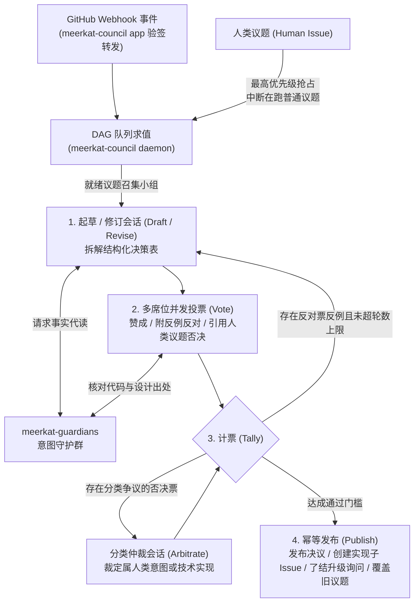

# meerkat-council

`meerkat-council` 是 [Meerkat](https://github.com/mouriya-s-lab/meerkat) 多 Agent 软件项目管理与自动交付系统中的**无状态议会守护进程与 `omp` 插件**（Go 守护进程 + TypeScript `omp` 扩展）。它负责维护议程仓库的议题依赖队列（DAG），按议题召集一次性无头 `omp` 审议小组，经多席位制衡表决产出技术与产品决议，并自动向目标代码仓库拆解发布实现子 Issue。

---

## 为什么采用“无状态一次性审议”架构

在多 Agent 自治研发体系中，议会承担着将模糊需求、架构分歧与升级提问转化为明确可执行工单的职责。若按传统方式让各席位以常驻长会话（Long-lived Session）形态持续处理所有议题，系统会迅速陷入两类结构性退化：

1. **跨议题上下文污染与角色漂移**：历史议题的争辩、已否决的旧方案以及长对话反复压缩（compact）留下的残缺摘要会不断堆积，导致席位逐渐偏离其法定的审查视角（例如本应只核对用户意图的席位开始纠缠底层代码细节，或技术审查席位放过显而易见的边界漏洞）。
2. **治理复杂度反噬业务本身**：一旦常驻会话出现失职、死循环或罢工，系统不得不额外部署“治理席位”“巡检 Agent”与心跳监控机制去督促常驻席位，使大量算力消耗在内部行政空转上。

`meerkat-council` 彻底废除常驻席位与私有数据库：**GitHub Issue、结构化评论标记与 GitHub Project 字段是议会的唯一状态源**。每当一个议题推进到起草、投票、仲裁或修订中的任一环节，守护进程都从 GitHub 上的标记实时推导当前所处阶段，拉起全新的无头 `omp` 会话，由插件守住该步骤的唯一目标，目标达成即销毁进程。因为每次会话只处理单一议题的单一环节，席位之间零历史包袱、零角色漂移，系统也无需任何治理巡检角色。

---

## 核心机制与审议闭环



### 1. 无优先级 DAG 调度与人类议题抢占

议会不维护人工优先级数值，而是将议程仓库中的全部议题及其 `Blocked by` 关系构建为有向无环图（DAG）进行求值：

- **依赖解锁**：只有当一个议题所依赖的前置人类议题全部定案（`Done`）或关闭后，该议题才解除阻塞、进入可召集（`ready`）状态。
- **人类议题最高抢占权**：人类在系统外直接提交的**人类议题（Human Issue）**拥有最高优先级。一旦队列中出现未决的人类议题，守护进程立即中断所有正在审议的普通议题（终止其在跑的无头 `omp` 会话并在 Issue 下记录中断快照），优先召集小组审议人类议题。待人类议题定案后，被该决议推翻的旧议题直接标记为已取代（`Superseded`）并关闭；未受波及的议题则从中断处自动恢复审议（可配置从原会话 `--fork` 续跑或全新拉起）。

### 2. 四类席位权责与多轮制衡表决

每个进入审议的议题都会按配置召集独立的席位组合。守护进程在每一步开始前重读 Issue 评论中的结构化标记，驱动小组完成多轮制衡：

- **起草与修订（Draft / Revise）**：具有起草权的席位通读议题背景（含由守护群升级上来的工人询问上下文），产出结构化决策表——逐行写明要改什么（`what`）、改哪里（`where`）、怎么改（`how`）、所属类别，以及需要下发到哪个代码仓库的实现工单标题与正文。
- **并发独立投票（Vote）**：草案发布后，守护进程为所有具有投票权的席位并发启动投票会话。各席位独立对决策表的每一行表态：
  - **赞成（`approve`）**：认可该行方案。
  - **反对（`oppose`）**：必须附带具体、可复现的反例（包含精确的文件路径与行号依据）。
  - **一票否决（`veto`）**：仅限具备否决权的原始意图守护席位使用，且必须引用具体的人类议题作为证据，指出该行违背了人类明确表达的意图。
- **分类争议仲裁（Arbitrate）**：当意图否决权行使在非直接否决类别的决策行上时，触发类别争议；由具备仲裁权的席位单独启动仲裁会话，裁定该行实质上属于“人类意图”还是“技术实现”，裁定落盘后重新执行计票。
- **计票与收敛（Tally）**：有效否决直接驳回对应行；存在反对票反例且当前轮次未达上限时，守护进程汇总所有席位的反例交回起草席启动下一轮修订；当赞成票达到法定比例阈值（如 $\lceil 3/4 \times \text{合格投票席位数} \rceil$）且无未决反对时，该行正式通过。

### 3. 只读议程仓与意图守护代读解耦

为了防止议会席位在庞大的业务代码库中迷失或重复消耗 Token，所有议会席位的本地工具权限被严格收缩为**只读议程仓库**。当席位在起草方案、验证反例或仲裁争议时需要核对业务代码、设计文档或 `omp` 定制配置，必须调用插件的代读工具向 [`meerkat-guardians`](https://github.com/mouriya-s-lab/meerkat-guardians) 发起请求，由守护群从对应模型的预热基座 `--fork` 出代读子会话，交回带出处的代码与设计事实。

### 4. 幂等发布与实现子 Issue 自动拆解

议题表决结束后，守护进程按顺序执行幂等发布（每一步写入前均先查询 GitHub 现有记录，进程中途重启可从断点无缝续跑）：

1. 为每个通过且包含交付项的决策行，在目标代码仓库创建实现 Issue，自动挂载为当前议题的 Sub-issue、写入 GitHub Project 字段，并在正文中注入指向该代码仓工作目录的 `omp-dispatch` 启动链接。
2. 若当前议题给出了对旧议题的覆盖声明，将受影响的旧议题标记为已取代（`Superseded`）并关闭。
3. 若当前议题源自编码工人在实现途中发起并由守护群升级的决策询问，按决议结论向原实现 Issue 写回回复或创建替代工单，从而唤醒 `omp-dispatch` 继续交付。
4. 发布最终决策评论，关闭当前议题并将 Project 状态置为完成（`Done`）。

---

## 双进程隔离与仓库组成

`meerkat-council` 编译为单一二进制文件，通过两个子命令实现公网 Webhook 接收端与内部核心守护进程的权限隔离：

| 子命令 / 路径 | 职责说明 |
|---|---|
| `meerkat-council app` | **无状态 Webhook 入口**：监听公网或隧道转发的 GitHub Webhook，校验 `X-Hub-Signature-256` 签名后，将议题、评论、子 Issue 与阻塞关系事件转发给 `daemon`。该进程不保存任何状态，也不接触 `GH_TOKEN` 或模型凭据。 |
| `meerkat-council daemon` | **议会核心守护进程**：持有 GitHub 与模型凭据，负责按事件增量更新与按周期全量重建议题队列，调度无头 `omp` 席位会话、执行计票与幂等发布，并向 [Meerkat 控制台](https://github.com/mouriya-s-lab/meerkat) 提供队列、会话日志与配置预校验 HTTP 接口。 |
| `plugin/` | **无头 `omp` 议会插件（TypeScript）**：为席位会话注入议题读取、守护代读、草案提交、逐行投票与分类仲裁工具；拦截未完成目标前的提前退出，并对工具入参做严格结构校验。 |
| `config.example/`、`scripts/` | 本地运行示例配置（含席位定义、计票门槛、代读映射、提示词模板，对接 `meerkat-e2e-*` 测试仓库）与 `omp` 目录初始化脚本。 |

---

## 本地运行与测试

运行依赖 Go、`omp`、`gh`（已登录，通过 `GH_TOKEN` 向 `daemon` 提供 GitHub 读写权限）、`yq`（v4），以及正在运行的 [`meerkat-guardians`](https://github.com/mouriya-s-lab/meerkat-guardians) 实例（其预热基座需覆盖 `council/proxy-readers.yaml` 中配置的代读模型）。

```sh
mkdir -p /Users/mouriya/Ext/work/meerkat-council-local
cp -R config.example /Users/mouriya/Ext/work/meerkat-council-local/config
scripts/prepare-omp-dir.sh /Users/mouriya/Ext/work/meerkat-council-local/config
openssl rand -hex 32 > /Users/mouriya/Ext/work/meerkat-council-local/webhook-secret
chmod 600 /Users/mouriya/Ext/work/meerkat-council-local/webhook-secret

export GH_TOKEN=$(gh auth token)
go run ./cmd/meerkat-council daemon --config-root /Users/mouriya/Ext/work/meerkat-council-local/config
go run ./cmd/meerkat-council app --config-root /Users/mouriya/Ext/work/meerkat-council-local/config
```

运行单测与静态检查：

```sh
go vet ./... && go test ./...
```
